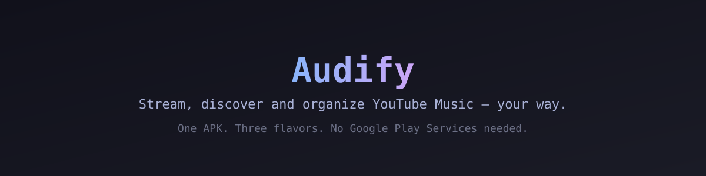
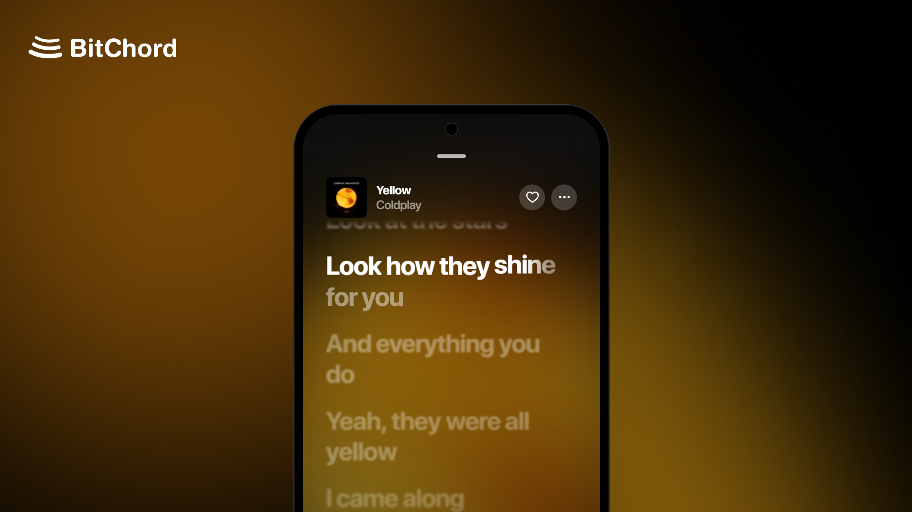

<div align="center">



<br/>

# Audify

### Aesthetic YouTube Music Client

Made by **[Sachit](https://github.com/sachit1751-art)**

<br/>

[](https://github.com/sachit1751-art/Audify/releases)
[](https://github.com/sachit1751-art/Audify/blob/main/LICENSE)
[](https://github.com/sachit1751-art/Audify/releases)
[](https://api.audify.kushagrasingh.in/api/stats/live)

<br/>

[**Download**](#download) · [**Features**](#features) · [**Build from source**](#build) · [**Contributing**](#contributing) · [**Support**](#support) · [**Disclaimer**](#disclaimer)

<br/>

<a href="https://fmhy.net/mobile#youtube-music" target="_blank" rel="noopener noreferrer"></a>
<a href="https://trendshift.io/repositories/177639?utm_source=trendshift-badge&utm_medium=badge&utm_campaign=badge-trendshift-177639" target="_blank" rel="noopener noreferrer"></a>
<a href="https://trendshift.io/repositories/177639?utm_source=trendshift-badge&utm_medium=badge&utm_campaign=badge-trendshift-177639" target="_blank" rel="noopener noreferrer"></a>

</div>

> [!IMPORTANT]
> Audify is not affiliated with, endorsed by, or connected to YouTube or Google in any way. Use it at your own discretion.

---

Audify is a free and open-source (GPLv3) client for YouTube Music: search, stream, queue and organize your music without ads, without Google Play Services, and with full control over how it looks and sounds. One APK covers the phone, and separate builds ship for Android TV and Wear OS.

---

<div align="center">



<h1><a id="features"></a>Features</h1>

<table>
  <tr>
    <td width="50%" valign="top">

#### Playback
- **Search, browse and play** anything available on YouTube Music.
- **Hi-Res lossless audio** — FLAC/ALAC from a configured module source, with YouTube Music as fallback.
- **Gapless playback with true crossfade**, adjustable 0–12s.
- **Automix [Beta]** — DJ-style transitions with beat-matching and tempo-stretching.
- **Offline downloads** — save tracks with embedded metadata.
- **Local music library** integration.
- **Background playback** via a proper foreground media session.
- **Apple-like lyrics animation** — credit to [binimum](https://github.com/binimum/am-lyrics).

#### Connectivity & Accounts
- **Sign in with your Google account** for personalized content.
- **Spotify integration** — connect your account to play your playlists and Liked Songs.
- **Discord Rich Presence** — in-app login, live track/artist/album and progress.
- **Scrobbling** to Last.fm and ListenBrainz.
- **Pluggable sources** — add, edit, test and health-check module sources.

    </td>
    <td width="50%" valign="top">

#### Experience
- **Animated album canvas** — motion artwork on the now-playing screen.
- **Word-synced lyrics** — word/syllable-level highlighting from multiple sources.
- **Lyrics providers** — credit to [lrc.red](https://lrc.red), [BiniLyrics](https://github.com/binimum), [BetterLyrics](https://github.com/better-lyrics/better-lyrics), [PaxSenix](https://lyrics.paxsenix.org), [LyricsPlus](https://github.com/ibratabian17/YouLyPlus), [SimpMusic](https://github.com/maxrave-dev/SimpMusic), [Unison](https://unison.boidu.dev), [Megalobiz](https://www.megalobiz.com), [KuGou](https://www.kugou.com), [LRCLIB](https://lrclib.net), [Musixmatch](https://www.musixmatch.com) and [Genius](https://genius.com).
- **Dynamic, artwork-driven theming** — Material palette extracted from album art.
- **Frosted-glass UI** — Telegram-style translucent bars via Haze, Material 3 theming.

#### Controls & Tweaks
- **Per-network audio quality** — separate quality ceilings for Wi-Fi and mobile data.
- **Playback speed control** (0.5×–2.0×) and **skip silence**.
- **Sleep timer** — fixed presets or "stop after this track".
- **System equalizer** integration.
- **Stats for nerds** — codec, bit depth, sample rate, and more on the now-playing screen.

    </td>
  </tr>
</table>

</div>

---

<div align="center">

<h1><a id="download"></a>Download</h1>

<a href="https://github.com/sachit1751-art/Audify/releases" target="_blank" rel="noopener noreferrer"></a>

Grab the latest signed APK from the [Releases](https://github.com/sachit1751-art/Audify/releases) page.

Each release ships one APK per CPU architecture — `arm64-v8a` for almost every modern phone, plus `armeabi-v7a`, `x86_64` and a `universal` build if you are unsure. Sideloading requires enabling "Install unknown apps" for whichever app you download it with.

</div>

---

<div align="center">

<h1><a id="build"></a>Build from source</h1>

</div>

Audify builds with the bundled Gradle wrapper — no Android Studio required.

```bash
# One signed release APK for the phone
./gradlew assembleProdRelease

# Everything at once — phone (4 ABIs), Android TV and Wear OS,
# copied into dist/ as fresh APKs
build-apks.bat        # Windows
```

Other useful targets: `assembleProdDebug`, `:tv:assembleProdRelease`, `:wearos:assembleProdRelease`.

**Release signing:** copy `keystore.properties.example` to `keystore.properties` and point it at your own `.jks` — the file is gitignored so passwords never land in the repo. CI signs automatically from repository secrets when you push to `main`.

**Requirements:** JDK 17 and the Android SDK (AGP 8.10.1, compileSdk 37).

---

<div align="center">

<h1><a id="contributing"></a>Contributing</h1>

We welcome contributions to Audify! Please review our [Contributing Guide](CONTRIBUTING.md) and [Code of Conduct](CODE_OF_CONDUCT.md) before submitting a Pull Request.

[**Contributing Guide**](CONTRIBUTING.md) · [**Code of Conduct**](CODE_OF_CONDUCT.md) · [**Additional Docs**](ADDITIONAL.md)

### Thanks to all contributors ❤

<a href="https://github.com/sachit1751-art/Audify/graphs/contributors">
  
</a>

</div>

---

<div align="center">

<h1><a id="support"></a>Support</h1>

Audify is free and always will be — if it's earned a spot in your rotation, you can chip in here:

<a href="https://ko-fi.com/kushagrasinghx" target="_blank" rel="noopener noreferrer"></a>
<a href="https://paypal.me/kuxhagrasingh" target="_blank" rel="noopener noreferrer"></a>

<br/>


</div>

---

<div align="center">

<h1><a id="disclaimer"></a>Disclaimer & Legal Notice</h1>

Audify is an independent, community-driven third-party audio player and client. It is **not** associated with Google LLC, YouTube Music, Deezer, Telegram, or any of their parent companies.

* **No Media Hosting:** Audify does not host, upload, or store copyrighted music files. It operates strictly as an interface to scan local device storage or stream media directly from public, public-facing, or user-authenticated APIs.
* **Fair Use & API Usage:** This software is created solely for personal research, educational, and fair-use purposes. The user is entirely responsible for ensuring their usage aligns with their local copyright laws and YouTube Terms of Service.
* **No Ad-Blocking Guarantee:** While Audify focuses on providing a clean listening environment, it does not guarantee permanent bypasses or modifications to commercial third-party platform conditions.
* **Copyleft:** Audify is free software under the GPLv3. The license does not let anyone forbid others from selling or redistributing copies, but any distribution must come with the Corresponding Source under the same license.

</div>

---

<div align="center">

<h1><a id="license"></a>License</h1>

This project is licensed under the **GNU General Public License v3.0 (GPLv3)**. See the [LICENSE](LICENSE) file for details.

<br/>

> **Audify** — made by [Sachit](https://github.com/sachit1751-art).

</div>
