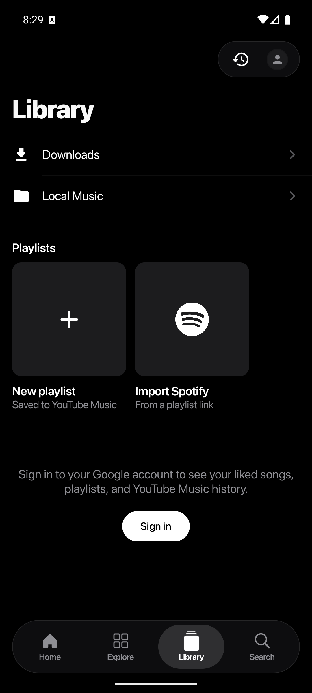
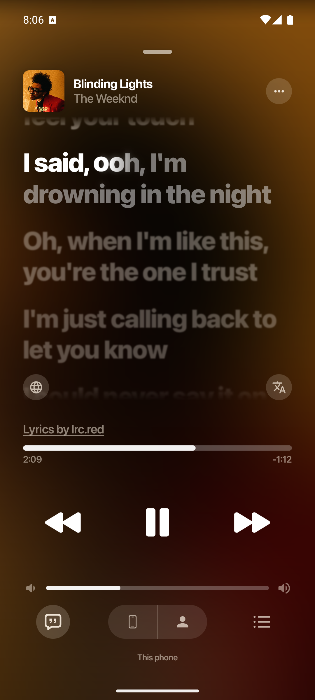

<!--
Copyright (c) 2026 Sachit. All rights reserved.
Project: AUDIFY
-->
<p align="center">
  
</p>

<p align="center">
  <strong>An open-source music player for Android, Android TV and Wear OS.</strong>
  <br>
  Discover music, manage your library, download for offline listening, and shape the way you listen.
</p>

<p align="center">
  <a href="https://github.com/sachit1751-art/Audify/releases"></a>
  <a href="https://github.com/sachit1751-art/Audify/blob/main/LICENSE"></a>
  <a href="https://github.com/sachit1751-art/Audify/releases"></a>
</p>

<p align="center">
  <strong><a href="https://github.com/sachit1751-art/Audify/releases/latest">Download the latest stable APK</a></strong>
  &nbsp;·&nbsp;
  <a href="https://github.com/sachit1751-art/Audify/releases">View all builds</a>
</p>

<p align="center">
  <a href="#screenshots">Screenshots</a> &middot;
  <a href="#features">Features</a> &middot;
  <a href="#build-from-source">Build from source</a> &middot;
  <a href="#contributing">Contributing</a>
</p>

Audify brings music discovery, library management, local playback, offline downloads, synchronized lyrics, and detailed playback controls into one customizable app. Listen on your phone, use the dedicated Android TV experience, or control playback from the Wear OS companion.

Audify is free and open-source software distributed under the GNU General Public License v3.0.

> **Independent project:** Audify is a third-party client. It is not affiliated with, endorsed by, or sponsored by Google or YouTube.

## Screenshots

These are captures from the app — not concept mockups.

<table>
  <tr>
    <td align="center" width="25%">
      
      <br><strong>Explore</strong>
      <br><sub>Find music and browse recommendations.</sub>
    </td>
    <td align="center" width="25%">
      
      <br><strong>Library</strong>
      <br><sub>Keep saved music and playlists organised.</sub>
    </td>
    <td align="center" width="25%">
      
      <br><strong>Now playing</strong>
      <br><sub>Follow along with timed lyrics.</sub>
    </td>
    <td align="center" width="25%">
      
      <br><strong>Lyric seek</strong>
      <br><sub>Jump to a moment through the lyrics.</sub>
    </td>
  </tr>
</table>

## Features

### Discover and organize

- **Music discovery:** Search for songs, albums, artists, and playlists through YouTube Music.
- **Personal library:** Sign in with your Google account to access supported personalized content.
- **Playlist management:** Create and organize playlists, edit supported playlist details, and manage the listening queue.
- **Local music:** Browse and play audio files stored on your device, including selected folders.

### Playback and audio

- **Background playback:** Keep listening while using other apps.
- **Gapless playback:** Move between tracks with minimal interruption.
- **Crossfade:** Blend consecutive tracks with an adjustable transition duration.
- **Automix (Beta):** Experiment with DJ-style transitions, beat matching, and tempo stretching.
- **Playback controls:** Adjust speed, skip silence, set a sleep timer, and use your device's system equalizer.
- **Audio quality:** Configure streaming quality separately for Wi-Fi and mobile data, with supported high-resolution output options.
- **Output selection:** Choose available audio outputs and inspect the active audio pipeline.

### Lyrics and interface

- **Synchronized lyrics:** Follow line- and word-level timing from supported lyric providers.
- **Lyrics navigation:** Seek through a track using its timed lyrics.
- **Animated artwork:** View motion artwork and album art on the now-playing screen.
- **Dynamic theming:** Let the interface draw colors from the currently playing artwork.
- **Material 3 design:** Customize the look and feel with a modern interface and translucent visual elements. Progressive top and bottom scroll-edge blur can be switched off independently in Settings.

### Downloads and connected services

- **Offline listening:** Download tracks with metadata for local playback.
- **Spotify integration:** Import supported playlist exports and access supported Spotify library features.
- **Discord Rich Presence:** Share the currently playing track and playback progress.
- **Scrobbling:** Send listening history to Last.fm and ListenBrainz.
- **External sources:** Configure supported source modules, including optional high-resolution audio sources.

### Available across devices

- **Android:** The full mobile listening experience.
- **Android TV:** A dedicated interface and build for television devices.
- **Wear OS:** A companion build for supported watches.

## Build from source

Audify uses the Gradle wrapper. You do not need to install Gradle separately. Android Studio is optional, but the Android SDK is required.

### Requirements

- **JDK 21** for the current Gradle and Kotlin toolchain.
- **Android SDK Platform 37** and the Android build tools required by the project.
- **Android NDK 28.2.13676358** for native components.
- Internet access for Gradle and dependency downloads on the first build.

The current build uses **Gradle 9.7.0**, **Android Gradle Plugin 9.3.1**, **Kotlin 2.4.21**, and **Compose Multiplatform 1.12.2**. Phone and TV builds compile against Android API 37, target API 36, and support API 26 and newer. The Wear OS build also compiles against API 37, targets API 36, and supports API 30 and newer.

### Build APKs

On Windows, build the production release variants with:

```bat
build-apks.bat
```

Or build individual variants with the Gradle wrapper:

```bash
# Android phone
./gradlew :app:assembleProdRelease

# Android TV
./gradlew :tv:assembleProdRelease

# Wear OS
./gradlew :wearos:assembleProdRelease
```

For a development build, use the corresponding `assembleDevDebug` task, for example:

```bash
./gradlew :app:assembleDevDebug
```

### Release signing

For local release signing, copy `keystore.properties.example` to `keystore.properties` and add your own signing configuration. Keep your keystore and credentials private; the local properties file is gitignored. CI release signing requires the repository's configured secrets.

## Contributing

Contributions, bug reports, and thoughtful suggestions are welcome. Before opening a pull request, read the [Contributing Guide](CONTRIBUTING.md) and [Code of Conduct](CODE_OF_CONDUCT.md). See [ADDITIONAL.md](ADDITIONAL.md) for further project documentation.

Use the dedicated [bug report form](https://github.com/sachit1751-art/Audify/issues/new?template=bug_report.yml) for reproducible problems, or the [tester feedback form](https://github.com/sachit1751-art/Audify/issues/new?template=tester-feedback.yml) for suggestions and general feedback. Both forms ask for the context needed to investigate without requesting account credentials or private listening history. Remove personal information from screenshots and logs before sharing them.

## Legal and third-party services

Audify is an independent third-party audio client. It is not associated with or endorsed by Google LLC, YouTube, YouTube Music, Deezer, Telegram, or their parent companies.

- **Media hosting:** Audify does not host or upload music. It accesses local media and third-party services through their available interfaces.
- **Third-party availability:** External services can change or restrict their interfaces at any time. Features that depend on them may stop working or vary by region.
- **User responsibility:** You are responsible for complying with applicable laws and the terms governing the services and content you access.
- **Trademarks:** Product names and trademarks belong to their respective owners.

## License

Audify is distributed under the [GNU General Public License v3.0](LICENSE). See the license text for the terms governing use, modification, and redistribution.
