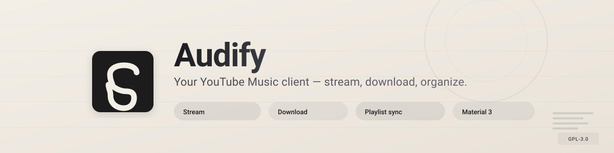
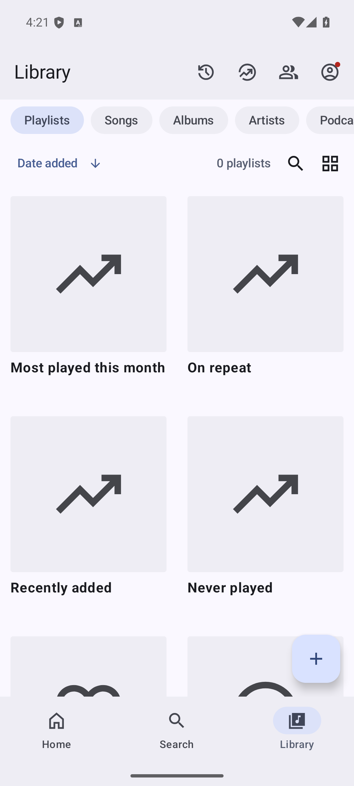

<div align="center">



# Audify

### Stream, discover and organize YouTube Music — your way.

<br/>

[](https://github.com/sachit1751-art/Audify/releases/latest)
[](https://github.com/sachit1751-art/Audify/blob/main/LICENSE)
[](https://github.com/sachit1751-art/Audify/releases)
[](https://f-droid.org/packages/com.sachit.music/)

<br/>

[**Download**](#download) · [**Features**](#features) · [**Build from source**](#build-from-source) · [**FAQ**](#faq) · [**Support**](#support)

</div>

> [!WARNING]
> **Regional restriction** — if YouTube Music is unavailable in your region, the app will not work without a **VPN or proxy** connecting to a supported region.

---

<div align="center">

## Screenshots


<br/>


<br/>


</div>

---

<div align="center">

## Features

</div>

### 🎵 Playback

| | |
|---|---|
| **Stream any song, album, artist, video or playlist** from YouTube Music | **Background playback** with media notification |
| **Download & cache** for offline listening | **One-tap song radio** from the player |
| **Play next / add to queue** from search results | **Skip silence** · **Sleep timer** |
| Remix / automix mode | Playlist shuffle with **queue skip marks** + "Earlier" boundary |

### 🔊 Audio

| | |
|---|---|
| **Audio normalization** — Quiet / Balanced / Loud / Aggressive presets | **Tempo & pitch control** |
| **Built-in equalizer** with presets | **Lossless / highest quality** audio option |
| **Per-network quality ceilings** — separate max quality for Wi-Fi vs mobile data | **Custom DSP** Effects |

### 📝 Lyrics & Discovery

| | |
|---|---|
| **Live synced lyrics** with word-by-word highlighting | **AI-powered lyrics translation** |
| **Current lyric line in the mini player** | **Lyrics translation on-tap** |
| **Music recognition** (Shazam-style) | **Romanization** support |
| Search songs, albums, artists, videos & playlists | Personalized quick picks |

### 📚 Library & Account

| | |
|---|---|
| **Full library management** with local playlists & imports | **Smart auto-playlists** — Most played this month · On repeat · Recently added · Never played |
| **Monthly & yearly recap** (Wrapped-style) — minutes, top artist & song | **Queue history** with skip tracking |
| **Reorder songs** in playlists and the queue | SIGN-IN **YouTube Music account** login & sync |
| **Stream source health** — per-song failure memory with automatic fallback | **In-player Signal panel** — live codec, bitrate, buffer, network info |

### 👥 Social

| | |
|---|---|
| **Listen together** with friends in real time | **Guest-aware** playback controls |
| Chromecast / Google Cast support | |

### 🎨 Interface

| | |
|---|---|
| **Material 3** design | **Home screen widget** & **shuffle-all quick-settings tile** |
| **Light / Dark / Black / Dynamic** theme modes | **Dynamic color** + 19 preset palettes |
| **Up Next peek** in the mini player | **Tap-to-pause** on artwork |
| **Artwork mesh backdrop** in the player | **Mini-player lyric line** |
| **System UI dark mode** support | **Per-network audio quality** toggles in settings |

---

## What's new

### Recent additions

- **Artwork mesh backdrop** — animated mesh gradient behind album art in the player (settings toggle)
- **Queue skip marks + Earlier boundary** — see what you skipped in the queue at a glance
- **Stream source health** — per-song failure memory; automatic fresh-resolution fallback on repeated failures
- **In-player Signal panel** — live codec, sample rate, bitrate, buffered vs played, network class, loudness offset
- **PlaybackTarget architecture** — consolidated transport verbs behind one interface, collapsed 20 duplicated Cast branches
- **Per-network audio quality ceilings** — separate max quality for Wi-Fi vs mobile data
- **Lossless / highest quality audio** option with FLAC/ALAC-preferred selection

> Full changelog: [Releases](../../releases) · [Changelog](changelog.md)

---

<div align="center">

## Download

### Get the latest release from GitHub, or add the repo to Obtainium for automatic updates.

<table>
  <tr>
    <th align="center">GitHub</th>
    <th align="center">Obtainium</th>
  </tr>
  <tr>
    <td align="center">
      <a href="https://github.com/sachit1751-art/Audify/releases/latest">
        
      </a>
    </td>
    <td align="center">
      <a href="https://apps.obtainium.imranr.dev/redirect?r=obtainium://add/https://github.com/sachit1751-art/Audify/">
        
      </a>
    </td>
  </tr>
  <tr>
    <td align="center">
      <a href="https://f-droid.org/packages/com.sachit.music/">
        
      </a>
    </td>
  </tr>
</table>

Every release ships three signed variants — pick the one that matches your device:

| Variant | Google Play Services | In-app updater | Best for |
|---------|:---:|:---:|----------|
| `Audify-foss` | ✗ | ✓ | Most users, de-Googled devices |
| `Audify-gms` | ✓ (Cast) | ✓ | Chromecast / Google Cast users |
| `Audify-izzy` | ✗ | ✗ | IzzyOnDroid repository users |

<sub>Tip: with Obtainium, track *releases* (not prereleases) to only receive stable builds.</sub>

</div>

---

## Tech stack

| | |
|---|---|
| **Language** | Kotlin 100% |
| **UI** | Jetpack Compose + Material Design 3 |
| **Playback** | AndroidX Media3 (ExoPlayer) |
| **Dependency injection** | Hilt |
| **Local storage** | Room database + DataStore preferences |
| **Networking** | Retrofit + OkHttp + Ktor |
| **Image loading** | Coil |
| **Async** | Kotlin Coroutines + Flow |
| ** минимум SDK** | 26 (Android 8.0) |
| **Target SDK** | 36 |

---

<div align="center">

## Build from source

</div>

**Prerequisites:** Android Studio (or the Android SDK), JDK 21, Git.

```bash
git clone https://github.com/sachit1751-art/Audify.git
cd Audify

# Debug build (fast, debug-signed, installable)
./gradlew :app:assembleFossDebug

# Release builds of every flavor (requires signing credentials — see below)
./gradlew :app:assembleFossRelease :app:assembleGmsRelease :app:assembleIzzyRelease
```

The debug APK lands at `app/build/outputs/apk/foss/debug/app-foss-debug.apk`.

For a fully automated build + signature verification + GitHub upload, use:

```bash
scripts/build-apks.sh [--with-tests] [--upload]
```

Release signing credentials are read from `local.properties` (`AUDIFY_RELEASE_STORE_*`); the keystore itself is **not** committed — provide your own and configure the same properties. Unit tests can be run with `./gradlew :app:testFossDebugUnitTest`.

---

<div align="center">

## FAQ

### Got questions? Check out the [FAQ page](https://sachitmusic.cc/#faq) for answers to the most common ones.

</div>

---

<div align="center">

## Support

- 🐛 Found a bug? [Open an issue](https://github.com/sachit1751-art/Audify/issues/new/choose)
- 💡 Have an idea? Feature suggestions are welcome in [Issues](https://github.com/sachit1751-art/Audify/issues) too
- ❓ Usage questions — start with the [FAQ](https://sachitmusic.cc/#faq)

If Audify is useful to you, consider giving the repo a ⭐ — it helps others discover it.

</div>

---

<div align="center">

## Acknowledgements

### Audify stands on the shoulders of incredible open-source work.

**Main inspirations**

| Project | Authors |
|---------|---------|
| **[InnerTune](https://github.com/z-huang/InnerTune)** | [Zion Huang](https://github.com/z-huang) · [Malopieds](https://github.com/Malopieds) |
| **[OuterTune](https://github.com/DD3Boh/OuterTune)** | [Davide Garberi](https://github.com/DD3Boh) · [Michael Zh](https://github.com/mikooomich) |
| **Sachit** | [Sachit](https://github.com/sachit1751-art) |

**Libraries & integrations**

| Project | Contribution |
|---------|--------------|
| **[Better Lyrics](https://better-lyrics.boidu.dev)** | Time-synced lyrics with word-by-word highlighting & YouTube Music integration |
| **[MusicRecognizer](https://github.com/aleksey-saenko/MusicRecognizer)** | Music recognition feature & Shazam API integration |
| **[zemer-cipher](https://github.com/ZemerTeam/zemer-cipher)** | YouTube cipher deobfuscation and PoToken generation |

Thanks to the entire open-source community — every library, tool and API that powers this project.

</div>

---

<div align="center">

## Disclaimer

This project is **not affiliated with, funded, authorized, endorsed by, or in any way associated** with YouTube, Google LLC, or any of their affiliates and subsidiaries.

All trademarks, service marks, and intellectual property rights referenced in this project belong to their respective owners.

Audify is licensed under **GPL-3.0** — see [LICENSE](https://github.com/sachit1751-art/Audify/blob/main/LICENSE).

<br/>

**Made with ❤️ by [Sachit](https://github.com/sachit1751-art)**

</div>
