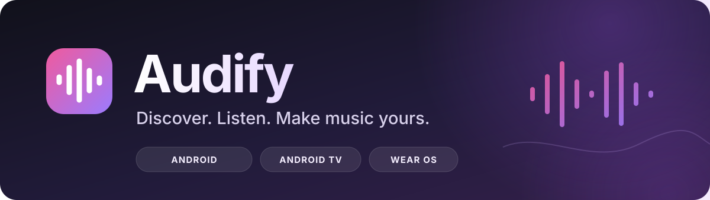
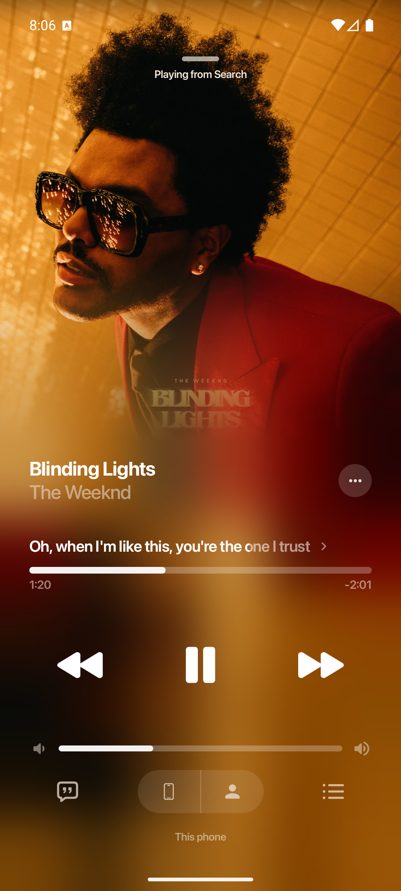
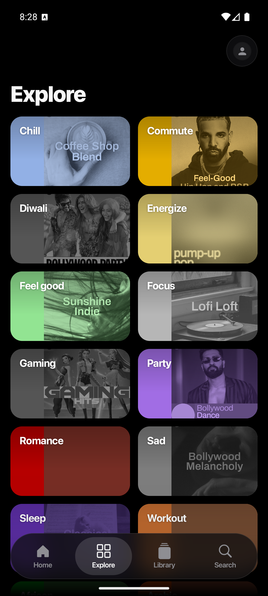

<!--
Copyright (c) 2026 Sachit. All rights reserved.
Project: AUDIFY
-->

<p align="center">
  
</p>

<h1 align="center">Your music. Your space. Your way.</h1>

<p align="center">
  An open-source music player for Android, Android TV, Wear OS and desktop.<br>
  Discover music, build your library, and make every listening session your own.
</p>

<p align="center">
  <a href="https://github.com/sachit1751-art/Audify/releases/latest"></a>
  <a href="https://github.com/sachit1751-art/Audify/blob/main/LICENSE"></a>
  <a href="https://github.com/sachit1751-art/Audify/releases"></a>
</p>

<p align="center">
  <a href="#downloads"><strong>↓ Download Audify 1.9.0</strong></a>
</p>

<p align="center">
  <a href="https://apps.obtainium.imranr.dev/redirect?r=obtainium%3A%2F%2Fadd%2Fhttps%3A%2F%2Fgithub.com%2Fsachit1751-art%2FAudify"></a>
  &nbsp;
  <a href="https://rookieenough.github.io/Orion-Data/app/?id=audify"></a>
  &nbsp;
  <a href="https://github.com/sachit1751-art/Audify/releases/latest"></a>
</p>

<p align="center">
  <a href="#screenshots">Screenshots</a> ·
  <a href="#features">Features</a> ·
  <a href="#platforms">Platforms</a> ·
  <a href="#build-from-source">Build</a> ·
  <a href="#community">Community</a>
</p>

> **Independent project:** Audify is a third-party client. It is not affiliated with, endorsed by, or sponsored by Google or YouTube.

## Screenshots

See Audify as it actually looks. These are captures from the app, not concept mockups.

<table>
  <tr>
    <td align="center" width="50%">
      
      <strong>Now playing</strong><br>
      <sub>Follow along with synchronized lyrics.</sub>
    </td>
    <td align="center" width="50%">
      
      <strong>Lyrics navigation</strong><br>
      <sub>Move through a track using its timed lyrics.</sub>
    </td>
  </tr>
  <tr>
    <td align="center" width="50%">
      
      <strong>Explore</strong><br>
      <sub>Discover music and browse recommendations.</sub>
    </td>
    <td align="center" width="50%">
      
      <strong>Your library</strong><br>
      <sub>Keep saved music and playlists organised.</sub>
    </td>
  </tr>
</table>

## Features

<table>
  <tr>
    <td width="50%" valign="top">

### 🎧 Playback & audio

- Background and gapless playback.
- Adjustable crossfade and Automix (Beta), including beat matching and tempo stretching.
- Playback speed, skip silence and sleep timer.
- System equalizer support, streaming quality controls and audio-output selection.

    </td>
    <td width="50%" valign="top">

### 🔎 Music discovery

- Search songs, albums, artists and playlists through YouTube Music.
- Sign in with a Google account for supported personalized content.
- Browse recommendations and explore music.

    </td>
  </tr>
  <tr>
    <td width="50%" valign="top">

### 📚 Library & playlists

- Create and organise playlists and edit supported playlist details.
- Manage the listening queue.
- Browse and play audio stored on your device, including selected folders.
- Import supported Spotify playlist exports and access supported Spotify library features.

    </td>
    <td width="50%" valign="top">

### ✨ Lyrics & personalisation

- Synchronized line- and word-level lyrics from supported providers.
- Seek through tracks using timed lyrics.
- Animated artwork and dynamic colour theming.
- Material 3 interface and optional progressive scroll-edge blur.

    </td>
  </tr>
  <tr>
    <td colspan="2" valign="top">

### ☁️ Offline listening & connected services

- Download supported tracks with metadata for offline listening.
- Discord Rich Presence for currently playing tracks and playback progress.
- Last.fm and ListenBrainz scrobbling.
- Configurable external source modules, including optional high-resolution audio sources.

    </td>
  </tr>
</table>
## Platforms

| Platform | Experience |
| --- | --- |
| **Android phones and tablets** | Full music discovery, library management, playback, lyrics and downloads. |
| **Android TV** | A dedicated TV experience for browsing and listening on a larger screen. |
| **Wear OS** | A companion experience for supported watch-based playback controls. |
| **Desktop (Windows)** | Native Rust desktop client. The 1.9.0 release provides a Windows x64 installer; macOS and Linux installers are not included in this release. See the [desktop project guide](desktop/README.md). |

## Downloads

The current stable release is **Audify 1.9.0**. Download the build for your device from the links below, or open the [complete GitHub release](https://github.com/sachit1751-art/Audify/releases/tag/v1.9.0) to view every asset and its checksum metadata.

| Platform | Download | Notes |
| --- | --- | --- |
| Android phone / tablet | [Universal APK](https://github.com/sachit1751-art/Audify/releases/download/v1.9.1/Audify-1.9.1.apk) | Recommended for most devices. |
| Android phone / tablet | [ARM64 APK](https://github.com/sachit1751-art/Audify/releases/download/v1.9.1/Audify-1.9.1_arm64-v8a.apk) · [ARMv7 APK](https://github.com/sachit1751-art/Audify/releases/download/v1.9.1/Audify-1.9.1_armeabi-v7a.apk) · [x86_64 APK](https://github.com/sachit1751-art/Audify/releases/download/v1.9.1/Audify-1.9.1_x86_64.apk) | Choose the ABI matching your device if you specifically need an architecture-specific package. |
| Android TV / Google TV | [AudifyTV 1.9.1 APK](https://github.com/sachit1751-art/Audify/releases/download/v1.9.1/AudifyTV-1.9.1.apk) | TV-specific interface; not the phone app. |
| Wear OS | [Universal Wear OS APK](https://github.com/sachit1751-art/Audify/releases/download/v1.9.1/AudifyWear-prod-universal-release.apk) | Companion app; requires a compatible phone app. |
| Windows x64 | [Audify Setup](https://github.com/sachit1751-art/Audify/releases/download/v1.9.1/Audify-Setup.exe) | Windows installer; currently unsigned. |

For installation notes and platform-specific requirements, see the [Android TV guide](tv/README.md), [Wear OS guide](wearos/README.md), and [Desktop guide](desktop/README.md). Linux and macOS desktop downloads are not available in 1.9.0.
## Community

- **Questions and ideas:** [GitHub Discussions](https://github.com/sachit1751-art/Audify/discussions)
- **Report a bug:** [Open a bug report](https://github.com/sachit1751-art/Audify/issues/new?template=bug_report.yml)
- **Suggest a feature:** [Submit a feature suggestion](https://github.com/sachit1751-art/Audify/issues/new?template=feature_request.yml)
- **Tester feedback:** [Share feedback](https://github.com/sachit1751-art/Audify/issues/new?template=tester-feedback.yml)
- **Contribute code:** Read the [Contributing Guide](CONTRIBUTING.md) and [Code of Conduct](CODE_OF_CONDUCT.md).
- **More project docs:** [Documentation index](docs/ADDITIONAL.md)

When reporting an issue, include clear reproduction steps and relevant app details. Remove personal information from screenshots and logs. Never share account credentials, tokens, or private listening data.

The Android app also supports direct anonymous bug reports and feature suggestions from Settings → About. These are published as public GitHub issues. The in-app submission service requires the one-time Worker secret described in [the feedback setup guide](backend/cloudflare/FEEDBACK_SETUP.md).

## Build from source

<details>
<summary><strong>Requirements and development setup</strong></summary>

Audify uses the Gradle wrapper; a separate Gradle installation is not required. Android Studio is optional, but the Android SDK is required.

For a repeatable setup on Windows, macOS or Linux, follow the [Development Environment Setup Guide](docs/DEVELOPMENT_ENVIRONMENT.md). On Windows, `scripts/first-run.ps1 -AcceptLicenses` bootstraps the SDK, runs the unit/JVM test gates, and builds phone, TV and Wear OS debug APKs in one flow.

- **JDK 21**
- **Android SDK Platform 37** and the Android build tools required by the project
- **Android NDK 28.2.13676358**
- Internet access for first-time Gradle and dependency downloads

Current Android toolchain: **Gradle 9.7.0**, **Android Gradle Plugin 9.3.1**, **Kotlin 2.4.21**, and **Compose Multiplatform 1.12.2**. Phone and TV builds compile against API 37, target API 36 and support API 26+. Wear OS compiles against API 37, targets API 36 and supports API 30+.

Desktop is a separate native Rust/GPUI application. Its toolchain, platform dependencies and build steps are documented in [`desktop/README.md`](desktop/README.md).

</details>

<details>
<summary><strong>Build APKs</strong></summary>

On Windows, build the production release variants with:

```bat
build-apks.bat
```

Or use the Gradle wrapper for an individual target:

```bash
# Android phone
./gradlew :app:assembleProdRelease

# Android TV
./gradlew :tv:assembleProdRelease

# Wear OS
./gradlew :wearos:assembleProdRelease
```

For a development build, use the corresponding `assembleDevDebug` task, for example:

```bash
./gradlew :app:assembleDevDebug
```

</details>

<details>
<summary><strong>Build the desktop app</strong></summary>

The desktop client lives in `desktop/` and uses the Rust toolchain pinned in `desktop/rust-toolchain.toml`.

```bash
cd desktop
cargo build --release --locked --package audify
```

This builds the native desktop executable for the host platform. For required system libraries, Windows installer creation, packaging and platform-specific instructions, follow the [desktop build guide](desktop/README.md).

</details>

<details>
<summary><strong>Local release signing</strong></summary>

Copy `keystore.properties.example` to `keystore.properties` and add your own signing configuration. Keep your keystore and credentials private; the local properties file is gitignored. CI release signing requires the repository's configured secrets.

</details>

## About and legal

Audify is free and open-source software distributed under the [GNU General Public License v3.0](LICENSE). Product names and trademarks belong to their respective owners.

Audify does not host or upload music. It accesses local media and third-party services through their available interfaces. External services may change, restrict access or vary by region; features that depend on them may consequently change or stop working. You are responsible for following applicable laws and service terms.

Audify is an independent third-party client and is not associated with or endorsed by Google LLC, YouTube, YouTube Music, Deezer, Telegram or their parent companies.

## Star History

[](https://www.star-history.com/#sachit1751-art/Audify&Date)

---

<p align="center">
  <a href="https://github.com/sachit1751-art/Audify/releases/latest"><strong>Get Audify</strong></a>
  &nbsp;·&nbsp;
  <a href="https://github.com/sachit1751-art/Audify/discussions">Join the discussion</a>
  &nbsp;·&nbsp;
  <a href="LICENSE">GPL-3.0</a>
</p>
